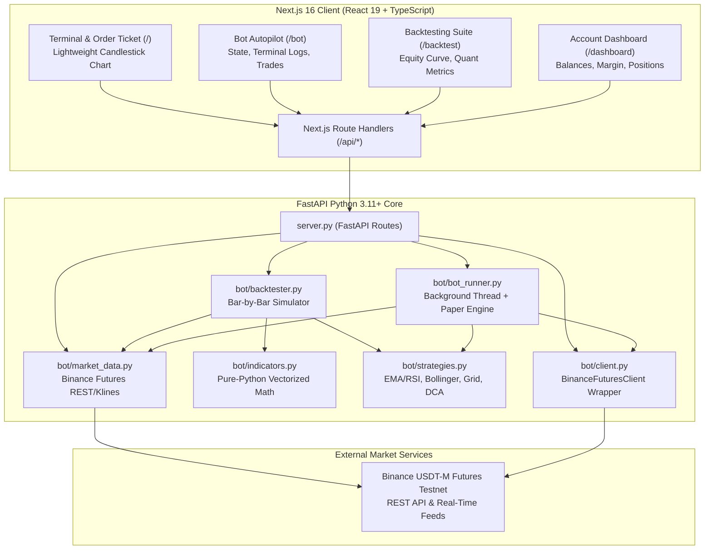

# Autonomous Algorithmic Trading & Analytics Platform

[](https://www.python.org/)
[](https://fastapi.tiangolo.com/)
[](https://nextjs.org/)
[](https://react.dev/)
[](https://testnet.binancefuture.com/)
[](LICENSE)

An institutional-grade, full-stack quantitative trading platform and automated bot suite for **Binance USDT-M Futures**. Features an autonomous strategy runner, simulated paper trading engine, bar-by-bar historical backtester with quantitative risk metrics (Sharpe ratio, Sortino ratio, Max Drawdown), and interactive TradingView candlestick charts.

---

## Table of Contents

- [System Architecture](#system-architecture)
- [Key Features](#key-features)
  - [1. Real-Time Trading Terminal & Candlestick Charts](#1-real-time-trading-terminal--candlestick-charts)
  - [2. Autonomous Strategy Bot & Paper Trading Engine](#2-autonomous-strategy-bot--paper-trading-engine)
  - [3. Quantitative Backtesting & Risk Analytics](#3-quantitative-backtesting--risk-analytics)
  - [4. Portfolio Dashboard & Account Surveillance](#4-portfolio-dashboard--account-surveillance)
- [Algorithmic Strategies](#algorithmic-strategies)
- [Quantitative Risk & Performance Formulas](#quantitative-risk--performance-formulas)
- [Tech Stack](#tech-stack)
- [Project Directory Structure](#project-directory-structure)
- [Prerequisites](#prerequisites)
- [Quickstart Guide](#quickstart-guide)
  - [1. Backend Setup](#1-backend-setup)
  - [2. Frontend Setup](#2-frontend-setup)
- [API Reference](#api-reference)
- [Resume / Portfolio Highlights](#resume--portfolio-highlights)

---

## System Architecture



---

## Key Features

### 1. Real-Time Trading Terminal & Candlestick Charts
- High-performance financial charts powered by **TradingView Lightweight Charts v5**.
- Multiple timeframe views (`1m`, `5m`, `15m`, `1h`, `4h`, `1d`) for major cryptocurrency pairs (`BTCUSDT`, `ETHUSDT`, `SOLUSDT`, `BNBUSDT`).
- Dynamic volume histogram with bullish/bearish color encoding.
- Live execution markers automatically plotted on the chart upon order placement.
- Real-time price display, 24h percentage delta, and auto-refresh intervals.

### 2. Autonomous Strategy Bot & Paper Trading Engine
- Background execution runner (`bot_runner.py`) running in a dedicated thread with configurable polling intervals (5s to 120s).
- **Two Execution Modes**:
  - **Paper Trading Mode**: Fully simulated portfolio with $10,000 virtual USD capital, realistic maker/taker fees (0.04%), position tracking, and live unrealized PnL.
  - **Live Testnet Mode**: Direct execution against Binance Futures Testnet with automatic timestamp drift synchronization.
- Real-time decision stream terminal showing tick evaluations, indicator values, and trade actions.
- Manual "Step Once" trigger for granular inspection of strategy decisions.

### 3. Quantitative Backtesting & Risk Analytics
- Event-driven, bar-by-bar backtesting engine that simulates realistic trade execution on historical market data.
- Built-in support for **Stop-Loss (SL)** and **Take-Profit (TP)** intra-candle triggers.
- Deducts exchange commissions (0.04%) and slippage buffers (0.05%) on every simulated fill.
- Quantitative risk metrics:
  - **Sharpe Ratio** (annualized risk-adjusted excess returns)
  - **Sortino Ratio** (downside risk-adjusted return)
  - **Maximum Drawdown %** and dollar peak-to-trough drop
  - **Win Rate %** and **Profit Factor** (gross gains vs gross losses)
  - **Benchmark Comparison** against passive Buy & Hold strategy
- Interactive SVG portfolio equity curve visualization vs. benchmark.
- Complete trade journal with entry/exit timestamps, execution prices, quantities, and exit reasons.

### 4. Portfolio Dashboard & Account Surveillance
- Summary cards showing Total Wallet Balance, Available Balance, Margin Balance, and Maintenance Margin.
- Open position monitor with leverage level, margin type (Cross/Isolated), mark price, entry price, and unrealized PnL.
- Active open orders and recent order history table.

---

## Algorithmic Strategies

| Strategy | Identifier | Core Indicators | Entry Logic | Exit Logic |
| :--- | :--- | :--- | :--- | :--- |
| **EMA Momentum + RSI** | `ema_rsi` | EMA(9), EMA(21), RSI(14) | Fast EMA crosses above Slow EMA while RSI < Overbought | Fast EMA crosses below Slow EMA or RSI reaches extreme overbought |
| **Bollinger Mean Reversion** | `bollinger_reversion` | Bollinger Bands(20, 2σ), RSI(14) | Price breaches lower band while RSI is oversold (≤ 35) | Price touches upper band or RSI is overbought (≥ 65) |
| **Grid Trading** | `grid` | Moving Average Baseline, % Spacings | Price dips below grid threshold from moving mean | Price rallies above grid threshold from moving mean |
| **DCA Pullback** | `dca` | High-water mark trailing channel | Price pulls back ≥ X% from recent 10-bar high | Hits Take-Profit target or exit signal |

---

## Quantitative Risk & Performance Formulas

All quantitative calculations are implemented in pure Python in [`bot/indicators.py`](file:///d:/Personal/TradingBot/backend/bot/indicators.py):

### 1. Annualized Sharpe Ratio
$$\text{Sharpe Ratio} = \frac{\mathbb{E}[R_p - R_f]}{\sigma(R_p - R_f)} \times \sqrt{N}$$
*(Where $N = 252 \times 24$ for hourly crypto trading frequency)*

### 2. Annualized Sortino Ratio
$$\text{Sortino Ratio} = \frac{\mathbb{E}[R_p - R_f]}{\sigma_{\text{downside}}} \times \sqrt{N}$$
*(Only penalizes downside volatility below target return)*

### 3. Maximum Drawdown (MDD)
$$\text{MDD} = \max_{t \in [0, T]} \left( \frac{\max_{\tau \in [0, t]} \text{Equity}_\tau - \text{Equity}_t}{\max_{\tau \in [0, t]} \text{Equity}_\tau} \right) \times 100\%$$

---

## Tech Stack

| Layer | Technologies |
| :--- | :--- |
| **Frontend Framework** | [Next.js 16](https://nextjs.org/) (App Router, Server Actions, API Route Handlers) |
| **UI & Styling** | [React 19](https://react.dev/), Vanilla CSS Design System, [Lucide Icons](https://lucide.dev/) |
| **Charting Engine** | [TradingView Lightweight Charts v5](https://tradingview.github.io/lightweight-charts/) |
| **Backend Framework** | [FastAPI](https://fastapi.tiangolo.com/), [Uvicorn](https://www.uvicorn.org/), Pydantic v2 |
| **Exchange Integration** | [python-binance](https://github.com/sammchardy/python-binance), Binance Futures Testnet REST API |
| **Language & Runtimes** | Python 3.11+, TypeScript 5.9+, Node.js 18+ |

---

## Project Directory Structure

```text
TradingBot/
├── backend/
│   ├── bot/
│   │   ├── backtester.py        # Bar-by-bar backtest simulation & quant analytics
│   │   ├── bot_runner.py        # Autonomous bot background loop & paper trading
│   │   ├── client.py            # Binance Futures Testnet wrapper
│   │   ├── config.py            # Environment configuration & credential loader
│   │   ├── exceptions.py        # Structured custom application errors
│   │   ├── indicators.py        # Pure-Python technical indicators & quant metrics
│   │   ├── logging_config.py    # Rotating file logging setup
│   │   ├── market_data.py       # Public candlestick data fetcher with fallbacks
│   │   ├── orders.py            # Order placement & formatting logic
│   │   ├── strategies.py        # Algorithmic strategy implementations (EMA, Grid, DCA)
│   │   └── validators.py        # Symbol, side, price, and quantity validators
│   ├── logs/                    # Rotating application logs (app.log)
│   ├── cli.py                   # Command-line interface for placing orders
│   ├── requirements.txt         # Python dependencies
│   ├── server.py                # FastAPI HTTP REST API
│   └── venv/                    # Local Python virtual environment
├── frontend/
│   ├── app/
│   │   ├── api/                 # Next.js API forwarding routes
│   │   │   ├── _lib/backend.ts  # Backend bridge & HTTP client
│   │   │   ├── backtest/        # POST /api/backtest
│   │   │   ├── bot/             # /start, /stop, /status, /tick, /reset
│   │   │   ├── dashboard/       # POST /api/dashboard
│   │   │   ├── klines/          # GET /api/klines
│   │   │   └── orders/          # POST /api/orders
│   │   ├── backtest/page.tsx    # Strategy Backtesting Suite UI
│   │   ├── bot/page.tsx         # Automated Bot Control Center UI
│   │   ├── components/
│   │   │   └── TradingChart.tsx # Lightweight Charts Candlestick Component
│   │   ├── dashboard/page.tsx   # Account Summary & Position Monitor
│   │   ├── globals.css          # Design system & dark trading terminal styles
│   │   ├── layout.tsx           # Root application layout
│   │   └── page.tsx             # Terminal & Order Ticket
│   ├── package.json
│   └── tsconfig.json
└── README.md
```

---

## Prerequisites

1. **Python 3.11+** installed.
2. **Node.js 18+** & `npm` installed.
3. *(Optional for live testnet orders)* [Binance Futures Testnet](https://testnet.binancefuture.com) account and API credentials. *(Paper trading works 100% out of the box without any API keys!)*

---

## Quickstart Guide

### 1. Backend Setup

Open a terminal and navigate to the backend directory:

```powershell
cd backend
```

Create and populate your `.env` file (optional if using Paper Trading):

```powershell
Copy-Item .env.example .env
```

```env
BINANCE_API_KEY=your_binance_testnet_api_key
BINANCE_API_SECRET=your_binance_testnet_api_secret
BINANCE_BASE_URL=https://testnet.binancefuture.com
FRONTEND_ORIGIN=http://localhost:3000
```

Start the FastAPI backend:

```powershell
.\venv\Scripts\Activate.ps1
uvicorn server:app --reload --host 0.0.0.0 --port 8000
```

- **Health Check**: `http://127.0.0.1:8000/health`
- **Swagger Documentation**: `http://127.0.0.1:8000/docs`

---

### 2. Frontend Setup

In a new terminal, navigate to the frontend directory:

```powershell
cd frontend
```

Install dependencies:

```powershell
npm install
```

Configure `.env.local` to point to the FastAPI backend:

```powershell
Copy-Item .env.example .env.local
```

```env
BACKEND_API_URL=http://127.0.0.1:8000
```

Start the Next.js development server:

```powershell
npm run dev
```

Open your browser to: **`http://localhost:3000`**

---

## API Reference

### Market Data & Trading
- `GET /api/klines?symbol=BTCUSDT&interval=1h&limit=300`: Returns historical OHLCV candlestick series.
- `POST /api/orders`: Submits a MARKET or LIMIT order to Binance Futures Testnet.
- `POST /api/dashboard`: Fetches balance summary, open positions, and order history.

### Quantitative Backtesting
- `POST /api/backtest`: Executes historical simulation and returns performance metrics, equity curve, and trade list.
  ```json
  {
    "symbol": "BTCUSDT",
    "interval": "1h",
    "limit": 500,
    "strategy_name": "ema_rsi",
    "initial_capital": 10000.0,
    "stop_loss_pct": 2.0,
    "take_profit_pct": 4.0,
    "strategy_params": {
      "fast_period": 9,
      "slow_period": 21,
      "rsi_period": 14
    }
  }
  ```

### Automated Bot Autopilot
- `POST /api/bot/start`: Starts the background bot loop in `PAPER` or `TESTNET` mode.
- `POST /api/bot/stop`: Halts the bot runner.
- `GET /api/bot/status`: Returns current bot execution state, paper portfolio balances, active positions, and logs.
- `POST /api/bot/tick`: Manually triggers a single tick evaluation.
- `POST /api/bot/reset`: Resets simulated paper trading capital to $10,000.

---

## Resume / Portfolio Highlights

This project demonstrates proficiency across the full spectrum of software engineering, quant finance, and frontend design:

1. **Autonomous Event-Driven Architecture**: Built an asynchronous strategy runner in Python utilizing threading locks, heartbeat timers, and state machine transitions.
2. **Quantitative Risk Modeling**: Implemented pure-Python vector math for Sharpe and Sortino ratios, maximum peak-to-trough drawdowns, and Wilder's smoothed RSI.
3. **High-Frequency Visualization**: Integrated TradingView Lightweight Charts in React 19 with dynamic volume histograms, execution markers, and responsive canvas scaling.
4. **Risk-Aware Order Execution**: Designed bracket orders with Stop-Loss and Take-Profit intra-candle simulation, slippage estimation, and fee accounting.
# Tradingbot

